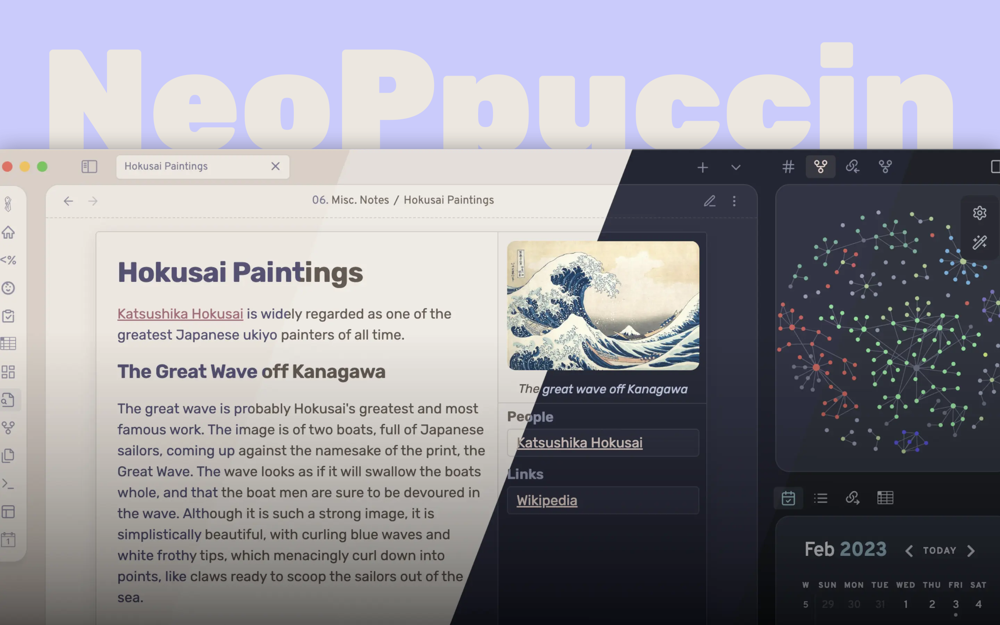

# NeoPpuccin
## A theme for [Obsidian](https://obsidian.md)

> **Note**: NeoPpuccin is a relatively new project. It will take a couple of weeks for everything to be documented and set up as intended — thanks for your patience while things are finalized!

> **Note**: Your AnuPpuccin settings are **not** transferred automatically. If you're migrating from AnuPpuccin, use the [settings converter](https://notnotnescap.github.io/NeoPpuccin/tools/settings-converter.html) to convert your exported style settings (or open `tools/settings-converter.html` from this repo directly).

<p align="center">  </p>

NeoPpuccin is a fork of [AnuPpuccin](https://github.com/AnubisNekhet/AnuPpuccin) that aims to continue it's development with bug fixes, new features and more colorschemes. 

NeoPpuccin is a theme for Obsidian that is designed to be minimalistic, clean and easy on the eyes. The theme supports various colorschemes (including [Catppuccin](https://catppuccin.com/)), layouts and features that can be toggled on and off using the [style settings](https://github.com/mgmeyers/obsidian-style-settings) plugin.

# Features

By default the theme provides a close-to-vanilla Obsidian experience with the Catppuccin colorscheme, but it can be customized to your liking using the [style settings](https://github.com/mgmeyers/obsidian-style-settings) plugin. The theme supports more colorschemes, different layouts and features that can be toggled on and off.


## Colorschemes

<p align="center">  </p>

The theme supports the following colorschemes:
- Atom
- Catppuccin (Latte, Frappe, Macchiato, Mocha, Mocha Old)
- Coffee
- Biscuit
- Everforest
- Dracula
- Gruvbox
- Nord (Nord Light, Nord Dark, Nord Darker)
- Notion
- Kanagawa
- Rosé Pine (Rosé Pine Dawn, Rosé Pine)
- Rosebox
- Royal Velvet
- Sandy Beaches
- Solarized
- thorns
- Generic (Dark, AMOLED Dark)

## Layouts

NeoPpuccin currently supports 3 layout variants: Default, Borders and Cards.

<p align="center">  </p>

## Rainbow folders

<p align="center">  </p>

Add a splash of color to your vault with the rainbow folders setting.

## Alternate tabs

<p align="center">  </p>

Customize your tabs style with the alternate tabs setting.

## Customisable Decorations

<p align="center">  </p>

Bold and italic colors can be toggled on and off and can be customised according to the palette as well.

## Callouts

<p align="center">  </p>

## Custom checkboxes & Speech bubbles

<p align="center">  </p>

When enabled, checkboxes can have more states than just checked and unchecked. The following table shows the available states and their syntax:

| Syntax  | Description     |
| ------- | --------------- |
| `- [ ]` | Unchecked       |
| `- [x]` | Checked         |
| `- [>]` | Rescheduled     |
| `- [<]` | Scheduled       |
| `- [!]` | Important       |
| `- [-]` | Cancelled       |
| `- [/]` | In Progress     |
| `- [?]` | Question        |
| `- [*]` | Star            |
| `- [n]` | Note            |
| `- [l]` | Location        |
| `- [i]` | Information     |
| `- [I]` | Idea            |
| `- [S]` | Amount          |
| `- [p]` | Pro             |
| `- [c]` | Con             |
| `- [b]` | Bookmark        |
| `- ["]` | Quote           |
| `- [u]` | Up              |
| `- [d]` | Down            |
| `- [w]` | Win             |
| `- [k]` | Key             |
| `- [f]` | Fire            |
| `- [0]` | Speech bubble 0 |
| `- [1]` | Speech bubble 1 |
| `- [2]` | Speech bubble 2 |
| `- [3]` | Speech bubble 3 |
| `- [4]` | Speech bubble 4 |
| `- [5]` | Speech bubble 5 |
| `- [6]` | Speech bubble 6 |
| `- [7]` | Speech bubble 7 |
| `- [8]` | Speech bubble 8 |
| `- [9]` | Speech bubble 9 |

## Colorful Frame

<p align="center">  </p>

Originally adapted from Kepano's [Minimal](https://github.com/kepano/obsidian-minimal) theme, "colorful frame" add some pop to your vault by displaying your accent color Around the edges of the editor and preview panes. The accent color can be changed in the style settings.

## Simplified markdown embeds

Markdown embeds have an alternate styling with an animated variant which can be toggled globally using style settings or individually using alt names for embeds, for example: `![[embed|alt-name]]`

| Embed style | Alt name |
| ----------- | -------- |
| Seamless    | seamless |

## Custom CSS Classes

Inserting these css classes into your note frontmatter will style your notes individually.

| CSS Class                   | Function                                                      |
| --------------------------- | ------------------------------------------------------------- |
| `heading-normal-toggle`     | Disables color in headings                                    |
| `decorations-normal-toggle` | Disables color in text decorations like **bold** and _italic_ |
| `hide-metadata`             | Hides metadata                                                |


# Installation
## Normal Installation
Go to your theme folder (`.obsidian/themes`) and run:

```sh
git clone git@github.com:notnotnescap/NeoPpuccin.git
```
## Updating
Go to your NeoPpuccin folder (`.obsidian/themes/NeoPpuccin`) and run:

```sh
git pull
```

## Building
Clone the github repo and run `sass src/base.scss theme.css` (or `make`) in the root folder.

## Colorschemes 

| Theme                                                     | Light Mode | Dark Mode | Extra Notes                                                                                                                 |
| --------------------------------------------------------- | ---------- | --------- | --------------------------------------------------------------------------------------------------------------------------- |
| [Atom](https://github.com/kognise/obsidian-atom)          | Yes        | Yes       | Accent value is hardcoded into the theme.                                                                                   |
| [Catppuccin](https://github.com/catppuccin/catppuccin)    | Yes        | Yes       | There are 4 variants of the dark theme, namely: Frappe, Macchiato, Mocha and Mocha Old.<br>The light theme is called Latte. |
| Coffee                                                    | No         | Yes       | Custom colorscheme                                                                                                          |
| [Biscuit](https://github.com/Biscuit-Colorscheme/biscuit) | Yes        | Yes       | -                                                                                                                           |
| [Everforest](https://github.com/sainnhe/everforest)       | Yes        | Yes       | -                                                                                                                           |
| [Dracula](https://github.com/dracula/dracula-theme)       | No         | Yes       | -                                                                                                                           |
| [Gruvbox](https://github.com/morhetz/gruvbox)             | Yes        | Yes       | -                                                                                                                           |
| [Nord](https://github.com/arcticicestudio/nord)           | Yes        | Yes       | A custom darker variant of the dark theme is included as well. <br> Accent value is hardcoded into the theme.               |
| Notion                                                    | Yes        | Yes       | -                                                                                                                           |
| [Kanagawa](https://github.com/rebelot/kanagawa.nvim)      | No         | Yes       | -                                                                                                                           |
| [Rosé Pine](https://github.com/rose-pine/rose-pine-theme) | Yes        | Yes       | The second variant of the dark theme, namely Rosé Pine dawn hasn't been implemented yet.                                    |
| [Rosebox](https://github.com/KraXen72/rosebox)            | No         | Yes       | Accent value is hardcoded into the theme.                                                                                   |
| [Royal Velvet](https://github.com/caro401/royal-velvet)   | No         | Yes       | -                                                                                                                           |
| Sandy Beaches                                             | Yes        | No        | Provided by [melnhh](https://github.com/melnhh)                                                                             |
| [Solarized](https://github.com/altercation/solarized)     | Yes        | Yes       | -                                                                                                                           |
| [thorns](https://codeberg.org/rini/thorns)                | No         | Yes       | -                                                                                                                           |

<details>

# Previews

<details>
<summary><h4>Atom</h4></summary>


</details>
<details>
<summary><h4>Catppuccin</h4></summary>
<h4 align="center">Latte</h4>

<h4 align="center">Frappe</h4>

<h4 align="center">Macchiato</h4>

<h4 align="center">Mocha</h4>

<h4 align="center">Mocha Old</h4>

</details>
<details>
<summary><h4>Generic</h4></summary>
<h4 align="center">Dark</h4>

<h4 align="center">AMOLED Dark</h4>

</details>
<details>
<summary><h4>Coffee</h4></summary>

</details>
<details>
<summary><h4>Biscuit</h4></summary>

</details>
<details>
<summary><h4>Everforest</h4></summary>


</details>
<details>
<summary><h4>Dracula</h4></summary>

</details>
<details>
<summary><h4>Gruvbox</h4></summary>


</details>
<details>
<summary><h4>Nord</h4></summary>
<h4 align="center">Nord Light</h4>

<h4 align="center">Nord Dark</h4>

<h4 align="center">Nord Darker (Custom Palette)</h4>

</details>
<details>
<summary><h4>Notion</h4></summary>


</details>
<details>
<summary><h4>Kanagawa</h4></summary>

</details>
<details>
<summary><h4>Rosebox</h4></summary>

</details>
<details>
<summary><h4>Rosé Pine</h4></summary>
<h4 align="center">Rosé Pine Dawn</h4>

<h4 align="center">Rosé Pine</h4>

</details>
<details>
<summary><h4>Royal Velvet</h4></summary>

</details>
<details>
<summary><h4>Sandy Beaches</h4></summary>

</details>
<details>
<summary><h4>Solarized</h4></summary>


</details>
</details>

# Integrations

- Excalidraw
- Kanban
- Style Settings

## Minimal Features

NeoPpuccin includes Minimal's [Cards](https://github.com/kepano/obsidian-minimal/blob/master/src/scss/features/cards.scss) snippet, used under its MIT license with full style settings support. You can support Kepano [here](https://www.buymeacoffee.com/kepano).

# Recommended Fonts

- **Interface**: [Overpass](https://fonts.google.com/specimen/Overpass)
- **Text**: [Rubik](https://fonts.google.com/specimen/Rubik)
- **Headings**: [Noto Serif](https://fonts.google.com/noto/specimen/Noto+Serif)


# Contributions

As mentionned at the top, NeoPpuccin is a fork of AnuPpuccin maintained by [AnubisNekhet](https://github.com/AnubisNekhet). You may see the [github page](https://github.com/AnubisNekhet/AnuPpuccin) to see the original theme and its contributors. If you want to contribute to NeoPpuccin, please submit a pull request or open an issue on this repository.

## If you like this theme
You can support me directly on my [my Ko-Fi page](https://ko-fi.com/erd). You can also support AnubisNekhet, the original author of AnuPpuccin, on his [Buy Me a Coffee page](https://www.buymeacoffee.com/anubisnekhet).

# License

NeoPpuccin is licensed under the GPL-3.0 license which allows you to modify the code freely, however the Copyright and license notices must be preserved in your CSS. If you redistribute a part of the code, please credit the theme in your CSS file.
